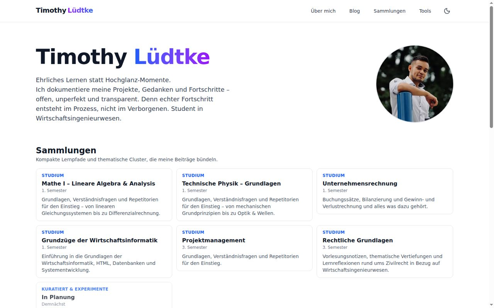

# Timothy Lüdtke's Personal Website

A modern, static **Next.js 15** personal website featuring file-based blog management with MDX, mathematical expressions, and interactive components. Built for educational content and optimized for performance.

**Live:** https://tluedtke.de



## Goal

My personal website, built around the idea of learning in the open: study notes, project write-ups and progress documented as they happen. It is a static site so it stays fast, cheap to host and has a minimal attack surface: no database, no API routes, content lives in version-controlled MDX files.

## Stack

Next.js 15 (App Router, static generation), React 19, TypeScript (strict), Tailwind CSS 4, MDX with KaTeX, Docker, Hetzner Object Storage for assets.

## 🚀 Features

- **Static Site Generation (SSG)** - Pre-rendered pages for optimal performance
- **MDX Blog System** - Write blog posts in Markdown with React components
- **Mathematical Expressions** - KaTeX rendering for educational content
- **Dark Mode** - System-aware theme switching
- **TypeScript** - Full type safety with IntelliSense support
- **Responsive Design** - Mobile-first approach with Tailwind CSS
- **Table of Contents** - Auto-generated from markdown headings

## 📁 Project Structure

```
├── content/blog/          # MDX blog posts
├── src/
│   ├── app/              # Next.js app router pages
│   ├── components/       # React components
│   ├── lib/              # Utility functions
│   └── styles/           # Global styles
├── public/               # Static assets
├── Dockerfile           # Production deployment
└── DEPLOY.md            # Deployment guide
```

## 🛠️ Development Setup

### Prerequisites

- **Node.js** 18+ (recommended: 20+)
- **npm** or **pnpm**

### Quick Start

1. **Clone the repository**
```bash
git clone <your-repo-url>
cd tgz-lol
```

2. **Install dependencies**
```bash
npm install
```

3. **Start development server**
```bash
npm run dev
```

4. **Open your browser** to [http://localhost:3000](http://localhost:3000)

### Available Scripts

- `npm run dev` - Start development server with Turbopack
- `npm run build` - Build production version
- `npm run start` - Start production server  
- `npm run lint` - Run ESLint checks
- `npm run tailwind:safelist` - Generate Tailwind CSS safelist

## 🖼️ Hetzner Object Storage Proxy

Images served from Hetzner Object Storage can be proxied through the built-in API route at `/api/images/[...key]`. Configure the following environment variables before running the server:

```
HETZNER_S3_ENDPOINT=https://fsn1.your-objectstorage.com
HETZNER_S3_REGION=eu-central-1
HETZNER_S3_BUCKET=tluedtke
HETZNER_S3_ACCESS_KEY=<your-access-key>
HETZNER_S3_SECRET_KEY=<your-secret-key>
```

Usage example in MDX:

```mdx
<Image src="/api/images/physik-1/tut-01-0202.jpeg" alt="Versatz" width={250} height={186} />
```

The API streams the object from Hetzner using signed requests, adds public caching headers, and preserves content metadata (type, last-modified). Only supply keys relative to the configured bucket (e.g. `physik-1/tut-01.jpeg`).

## ✏️ Creating Blog Posts

### Adding New Posts

1. **Create MDX file** in `/content/blog/`
2. **Name format**: `slug-name.mdx`
3. **Add frontmatter** with metadata

### Frontmatter Structure

```yaml
---
title: "Your Post Title"
date: "2025-01-12"
excerpt: "Brief description for previews"
tags: ["nextjs", "typescript", "education"]
published: true
---
```

### Writing Content

```mdx
---
title: "Learning Next.js 15"
date: "2025-01-12"
excerpt: "A comprehensive guide to Next.js 15 features"
tags: ["nextjs", "react", "webdev"]
published: true
---

# Introduction

This post covers the latest features in Next.js 15.

## Key Features

- **App Router** improvements
- **Turbopack** integration  
- Enhanced **Static Site Generation**

### Mathematical Expressions

You can include math using KaTeX syntax:

$$
E = mc^2
$$

Inline math: $x = \frac{-b \pm \sqrt{b^2-4ac}}{2a}$
```

## 🎨 Customization

### Styling

- **Tailwind CSS 4** for utility-first styling
- **Dark mode** via CSS classes
- **Typography plugin** for prose content
- **Custom colors** defined in Tailwind config

### Components

Create reusable components in `/src/components/` and import them directly in MDX files.

### Markdown Features

- **GitHub-flavored Markdown** (tables, code blocks, etc.)
- **Automatic heading anchors** with `rehype-slug`
- **Math expressions** with KaTeX
- **Syntax highlighting** for code blocks
- **Table of Contents** auto-generation

## 🚀 Deployment

### Production Build

```bash
npm run build
npm run start
```

### Docker Deployment

Built-in Docker support for production deployment:

```bash
docker build -t personal-website .
docker run -p 3000:3000 personal-website
```

### Coolify Deployment

See [DEPLOY.md](./DEPLOY.md) for complete Coolify deployment instructions.

## 📊 Performance

- **Lighthouse Score**: 95+ across all metrics
- **Static Generation**: All pages pre-rendered at build time
- **Optimized Images**: Next.js Image component with optimization
- **Fast Builds**: Turbopack for development and builds
- **Minimal Bundle**: No database dependencies

## 🔧 Configuration

### Environment Variables

For development, create `.env.local`:

```bash
# Optional: Disable Next.js telemetry
NEXT_TELEMETRY_DISABLED=1
```

### TypeScript

Full TypeScript support with strict mode enabled:
- Type-safe blog utilities
- Component props validation  
- Comprehensive type coverage

## 📱 Browser Support

- **Modern browsers** (Chrome, Firefox, Safari, Edge)
- **Mobile responsive** design
- **Progressive enhancement** for older browsers

## 🤝 Contributing

1. Fork the repository
2. Create a feature branch
3. Make your changes
4. Test locally
5. Submit a pull request

## 📄 License

This project is personal use. Feel free to use as inspiration for your own website!

---

**Built with ❤️ using Next.js, TypeScript, and Tailwind CSS**
